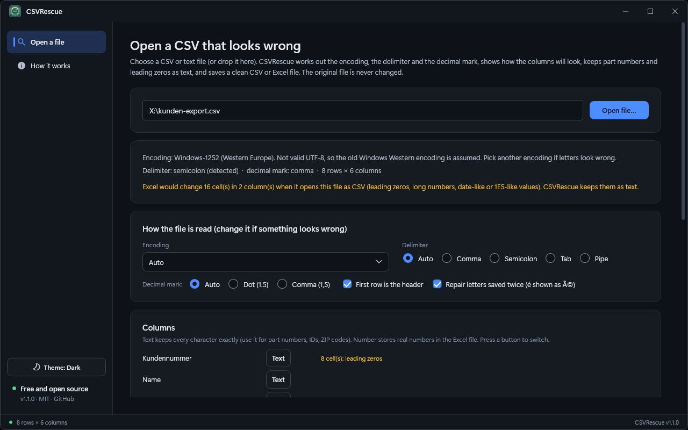
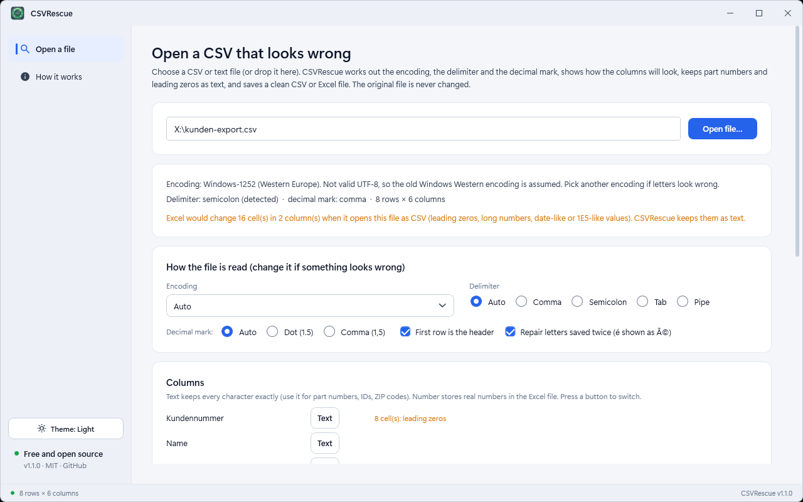

# CSVRescue — CSV Encoding, Delimiter and Excel Cleaner

A Windows desktop tool (**.NET 10 / WPF**) that makes a CSV or text export readable again and saves it in a form Excel will not damage. It works out the encoding, the delimiter and the decimal mark, shows how the columns will look, keeps part numbers and leading zeros as text, and saves a clean CSV or Excel (.xlsx) file. The original file is never changed.



<details><summary>Light theme</summary>



</details>

## Download

Get the installer from the [latest release](https://github.com/md-anamul-hasan/csvrescue/releases/latest) (Windows 10/11, 64-bit; self-contained, no .NET install needed) and check it against `SHA256SUMS.txt`. Release builds are intended to be code-signed with a free certificate from the [SignPath Foundation](https://signpath.org/) (see [Code signing policy](#code-signing-policy)); until the project is approved, Windows SmartScreen may warn about an unknown publisher.

## What it does

| Area | Behaviour |
|---|---|
| Encoding | Byte order mark (UTF-8, UTF-16, UTF-32), UTF-16 without one, valid UTF-8, otherwise Windows-1252; override with Windows-1250/1251/1253/1254/1257, ISO-8859-1/2, Shift-JIS, GBK, Big5, EUC-KR or IBM437 |
| Delimiter and decimal mark | Detects comma, semicolon, tab or pipe, and decimal comma versus dot; every choice can be overridden |
| Repairs mojibake | Text saved as UTF-8 twice (é shown as é) is repaired when the repair is clean |
| Text or number | A column is Number only when every value is a clean number; IDs, part numbers, leading zeros, 16+ digit numbers and date-like or 1E5-like values stay Text. Switch any column |
| Saves safely | Excel (.xlsx) with Text cells, real numbers, bold frozen header and fitted widths; or CSV in UTF-8 (with or without BOM) with comma, semicolon or tab |
| Reports problems | Rows with a different number of columns, empty lines, stray quotes and a missing closing quote |
| Other | Opens files up to 300 MB; drag a file onto the window or run `CSVRescue.exe <file>`; dark/light/system theme |

### Command line

```
CSVRescue.exe <file>
```
Opens the file at once (also works with *Open with* and drag-and-drop onto the exe).

Full walkthrough: [docs/USER_GUIDE.md](docs/USER_GUIDE.md).


## Build, test, run

```powershell
dotnet build CSVRescue.slnx
dotnet test  CSVRescue.slnx

# Self-contained installer in dist\installer (needs Inno Setup 6: winget install JRSoftware.InnoSetup)
.\scripts\build-installer.ps1

# Installer plus SHA256SUMS.txt in dist\release, ready to upload
.\scripts\package-release.ps1
```

The version comes from `Directory.Build.props`. Building needs the .NET 10 SDK; the installed app needs nothing else.

## Layout

```
Services/          encoding/delimiter detection, CSV reader, xlsx/CSV writers, themes
ViewModels/        MVVM: MainViewModel, ShellViewModel
Controls/          title bar, status bar
Themes/            design tokens (dark/light), controls, icons
CSVRescue.Tests/   xUnit: detection, parsing, repair, writers
scripts/           build-installer.ps1, package-release.ps1, capture-media.ps1 (screenshots)
Directory.Build.props  single source of the product version
```

## Known limitations

- A plain CSV cannot carry the information that a value is text; use the .xlsx output when it matters.
- At most 1,048,576 rows in an .xlsx file.
- Windows 10 (21H2+) and Windows 11, 64-bit only.

## License

[MIT](LICENSE). Free for personal and commercial use.

## Code signing policy

Free code signing for release builds is provided by [SignPath.io](https://about.signpath.io/), with a certificate from the [SignPath Foundation](https://signpath.org/), once the project is approved.

- Releases are built and signed only by the GitHub Actions workflow `.github/workflows/release.yml` from tagged commits of this repository.
- Only CSVRescue's own binary and its installer are signed.
- Maintainer and approver: Md Anamul Hasan ([@md-anamul-hasan](https://github.com/md-anamul-hasan)).

## Privacy

Full policy: [docs/PRIVACY.md](docs/PRIVACY.md).

CSVRescue makes no network connections and has no telemetry or update check. It reads the file you open and writes only the file you save.
