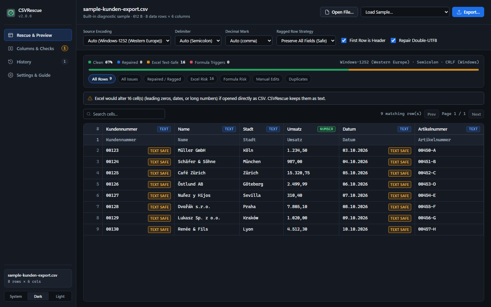
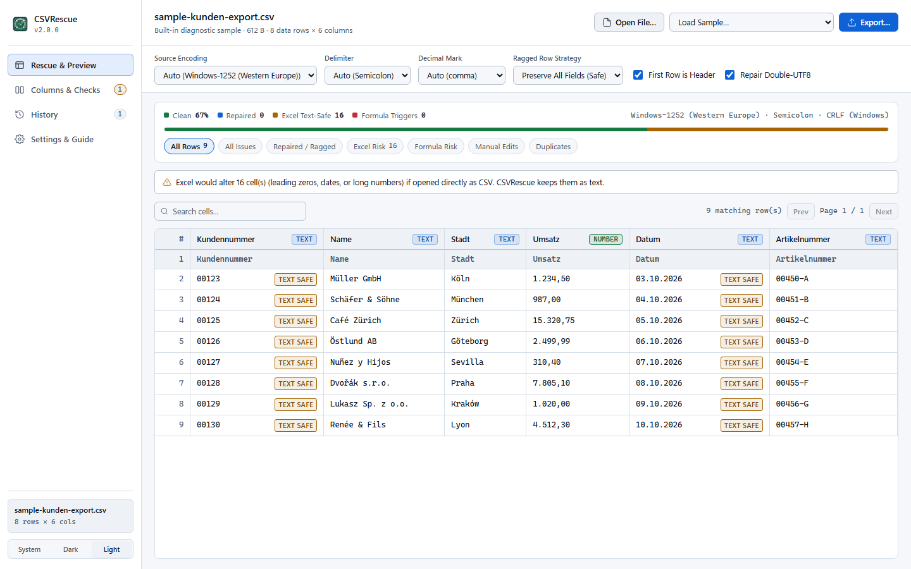

# CSVRescue — Native Rust CSV Diagnostic, Repair & Recovery Tool

A native **Rust + Tauri 2.x** desktop application for Windows 10/11 (x64) that diagnoses, recovers, validates, and safely exports malformed or damaged CSV and delimited text files without changing original source files or losing data to Excel auto-formatting.



<details><summary>Light theme</summary>



</details>

## Download

Get the installer or portable ZIP from the [latest release](https://github.com/md-anamul-hasan/csvrescue/releases/latest) (Windows 10/11 64-bit; `5.39 MiB` native binary / `3.75 MiB` installer; zero `.NET` or Node.js runtime needed) and verify checksums against `SHA256SUMS.txt`. Release builds are intended to be code-signed through the [SignPath Foundation](https://signpath.org/) (see [Code signing policy](#code-signing-policy)); until signing approval is active, Windows SmartScreen may warn about an unknown publisher.

## Capabilities

| Area | Behavior |
|---|---|
| **Encoding & Unicode** | Detects UTF-8 / UTF-16 LE & BE / UTF-32 LE & BE BOMs, BOM-less UTF-16 via zero-byte distribution, strict UTF-8, and Windows-1252 fallback; manual override across 20 encodings (`encoding_rs`) with explicit lossy character counts |
| **Mojibake Repair** | Automatically detects and cleanly reverses double-encoded UTF-8 sequences (`é` -> `é`, `€` -> `€`, `M8 × 20` -> `M8 × 20`) when reversible byte-for-byte |
| **Delimiter, Quote & Header** | Detects `,`, `;`, `\t`, `|` delimiters, doubled-quote vs. backslash escapes, CRLF/LF/CR line endings, header rows, and `Dot` vs. `Comma` decimal marks |
| **Recovery Strategies** | Supports `Preserve` (keep source records verbatim with diagnostics) and `AlignColumns` (pad short rows and merge split fields only when numeric column profiles yield a unique alignment); flags multi-candidate rows as `Ambiguous` |
| **Side-by-Side Inspection** | Inspect Original vs. Recovered rows per cell, filter by issue kind (`Problems`, `Repaired / Ragged`, `Excel Risk`, `Formula Risk`, `Manual Edits`, `Duplicates`), and override or revert individual cells |
| **Excel & Formula Protection** | Keeps leading zeros (`00123`, `-0042`), 16+ digit numbers, `1E5` codes, and dates (`01-02`, `1/2`) as `Text`; flags formula triggers (`=`, `+`, `-`, `@`, `\t`, `\r`) and offers opt-in idempotent `'` sanitization |
| **Safe Atomic Export** | Writes pure-Rust OpenXML `.xlsx` (explicit `@` text format `numFmtId="49"`, native numeric cells, bold frozen header, XML control-char stripping, up to 1,048,576 rows) and clean CSV, Markdown/JSON recovery reports, and dry-run previews; blocks overwriting the open source file |
| **Performance & Scale** | Handles files up to **300 MiB** locally (`~800 ms` total load + CSV + XLSX export on 200k European rows, `~192 MB` working set); drag-and-drop onto window or run `CSVRescue.exe <file>` |

### Command Line

```powershell
CSVRescue.exe <path-to-file.csv>
```

Opens the file immediately on launch (also works with Windows Explorer *Open with*).

Walkthrough & details: [docs/USER_GUIDE.md](docs/USER_GUIDE.md), [docs/ARCHITECTURE.md](docs/ARCHITECTURE.md), and [docs/SECURITY_AUDIT.md](docs/SECURITY_AUDIT.md).

## Build, Test & Package

Prerequisites: stable Rust toolchain (with `rustfmt` and `clippy`), Node.js 22+ (build-time only for `src-ui`), and [Inno Setup 6](https://jrsoftware.org/isinfo.php) (`winget install JRSoftware.InnoSetup`) for packaging.

```powershell
# 1. Build frontend presentation assets
Push-Location src-ui
npm ci
npm run build
Pop-Location

# 2. Verify formatting, lints, and Rust test suite
cargo fmt --all -- --check
cargo clippy --workspace --all-targets -- -D warnings
cargo test --workspace --all-targets

# 3. Supply-chain & vulnerability audit (optional local tools: cargo-audit, cargo-deny)
cargo deny check
cargo audit

# 4. Run 200,000-row benchmark
cargo run --release -p csvrescue-core --example bench

# 5. Build installer, portable ZIP, and SHA256SUMS.txt into dist\release\
.\scripts\package-release.ps1
```

The single source of product version is [Cargo.toml](Cargo.toml) (`[workspace.package] version`) paired with [crates/csvrescue-app/tauri.conf.json](crates/csvrescue-app/tauri.conf.json).

## Repository Layout

```text
crates/
├── csvrescue-core/    Pure-Rust parsing, encoding, recovery, validation & CSV/XLSX engine + tests & bench
└── csvrescue-app/     Tauri 2.x Windows desktop shell, capabilities, CSP & IPC commands
src-ui/                TypeScript + React 19 UI (compiled by Vite into embedded static assets)
docs/                  Architecture, Security Audit, Migration Inventory, Benchmarks & User Guide
installer/             Inno Setup 6 script (csvrescue.iss)
scripts/               Release packaging scripts (build-installer.ps1, package-release.ps1)
deny.toml              cargo-deny license, source & advisory policy
```

## Limitations

- Plain `.csv` files have no standard type metadata; export to `.xlsx` whenever preserving leading zeros or long numeric IDs in Excel matters.
- Excel `.xlsx` worksheets enforce OpenXML limits (`1,048,576` rows, `16,384` columns, `32,767` characters per cell).
- Windows 10 (21H2+) and Windows 11 64-bit only (requires Windows WebView2 Runtime).

## License

[MIT](LICENSE). Free for personal and commercial use. Third-party notices live in [THIRD_PARTY_NOTICES.md](THIRD_PARTY_NOTICES.md).

## Code Signing Policy

Free code signing for release builds is provided by [SignPath.io](https://about.signpath.io/), with a certificate from the [SignPath Foundation](https://signpath.org/), once approved.

- Official releases are built and signed only by [release.yml](.github/workflows/release.yml) from tagged repository commits.
- Only CSVRescue's own executable (`CSVRescue.exe`) and Inno Setup installer (`CSVRescue-Setup-*.exe`) are signed; runtime dependencies stay unmodified.
- Maintainer and approver: Md Anamul Hasan ([@md-anamul-hasan](https://github.com/md-anamul-hasan)).

## Privacy

Full policy: [docs/PRIVACY.md](docs/PRIVACY.md).

CSVRescue makes zero network connections, collects no telemetry, and never modifies your original CSV files.
