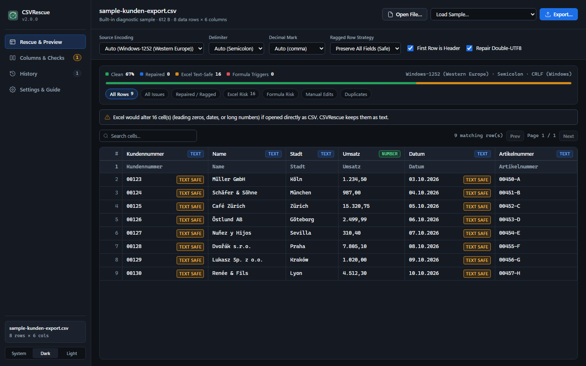

## CSVRescue 2.0.0

CSVRescue 2.0.0 is a **complete native Rust + Tauri 2.x rewrite and Fluent 2 UI redesign**, replacing the legacy .NET 10 / WPF implementation while remaining **100% free, offline, and MIT-licensed**.

### Highlights
- **90.9% smaller executable (`5.39 MiB`) & 93.1% smaller installer (`3.75 MiB`):** No bundled .NET runtime; ships both an in-place upgrading installer (preserving existing AppId) and a portable Win64 ZIP (`2.26 MiB`).
- **57.5% less RAM (`192.2 MB` vs. `452.7 MB` on 200k rows) & >2x faster CSV export (`40–53 ms`):** Backed by pure-Rust decoding, streaming tolerant parsing, and dependency-free OpenXML `.xlsx` compression (`zip 9.5.1`).
- **Deeper Recovery & Transparency:** Choose `Preserve` or `AlignColumns` recovery strategies, review confidence levels (`High` / `Medium` / `Low` / `Ambiguous`), inspect Original vs. Recovered diffs side-by-side, and edit or revert individual cells manually.
- **Stronger Safety & Validation:** Signed leading-zero (`-0042`) protection, duplicate row/header & whitespace/control-char audit, spreadsheet formula injection detection with opt-in idempotent `'` sanitization, `ExportModal` live dry-run preview, and Markdown/JSON recovery reports.
- **Supply-Chain Hardened:** Passes `cargo deny check` and `cargo audit` with zero vulnerabilities, strict WebView2 CSP (`connect-src 'self' ipc:`), and Win32 DLL search-path hardening (`LOAD_LIBRARY_SEARCH_SYSTEM32`).

### Release Files

| File | Purpose |
|---|---|
| `CSVRescue-Setup-2.0.0.exe` | Windows x64 Inno Setup installer (`3.75 MiB`) |
| `CSVRescue-2.0.0-win64-portable.zip` | Portable Win64 archive (`2.26 MiB`, extract and run `CSVRescue.exe`) |
| `SHA256SUMS.txt` | Lowercase SHA-256 checksums for verification |

Verify a download: `Get-FileHash .\CSVRescue-Setup-2.0.0.exe -Algorithm SHA256` and compare with `SHA256SUMS.txt`.

Full documentation: [CHANGELOG.md](https://github.com/md-anamul-hasan/csvrescue/blob/main/CHANGELOG.md), [ARCHITECTURE.md](https://github.com/md-anamul-hasan/csvrescue/blob/main/docs/ARCHITECTURE.md), and [SECURITY_AUDIT.md](https://github.com/md-anamul-hasan/csvrescue/blob/main/docs/SECURITY_AUDIT.md).
